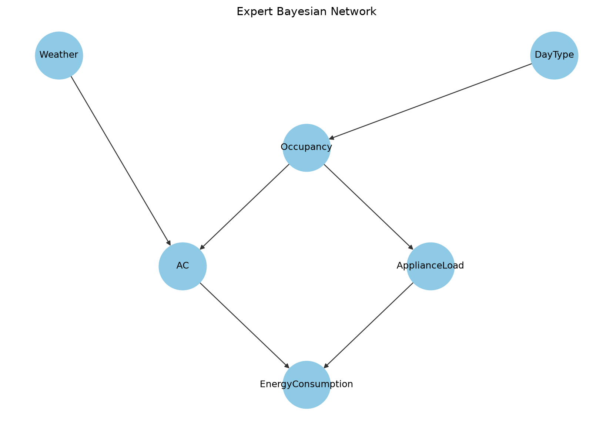

# Problem 1 Analysis Report

Random seed: `2026`

## Part A — Expert Bayesian Network

CPT verification issues: `[]`

### Expert query results

| Query | Probability |
|---|---:|
| Q1 P(E=High) | 0.58063104 |
| Q2 P(E=High|W=Hot) | 0.70626575 |
| Q3 P(E=High|D=Weekend) | 0.64019850 |
| Q4 P(E=High|W=Cold,O=High) | 0.48425000 |
| Q5 P(W=Hot|E=High) | 0.60818808 |
| Q6 P(A=On|E=High) | 0.69286668 |
| Q7 P(A=On|E=High,L=Heavy) | 0.64989930 |

#### Q1 hand calculation

The code evaluates the following marginalization:
P(E=High) = Σw,d,o,a,l P(w)P(d)P(o|d)P(a|w,o)P(l|o)P(E=High|a,l).

The contribution after summing DayType, Occupancy, AC, and Appliance Load for each Weather value is:
- Weather = Hot: 0.35313288
- Weather = Mild: 0.14747584
- Weather = Cold: 0.08002233

Therefore: P(E=High) = 0.35313288 + 0.14747584 + 0.08002233 = **0.58063104**.

This matches the exhaustive joint-enumeration result produced by the code.

### Q6/Q7 explaining away

Q6 is the probability AC is on given only high energy; Q7 also fixes a heavy appliance load. Heavy load already explains energy use, so it weakens the evidence in favor of AC being on. This is the explaining-away effect.

## Part B — Conditional independence

| Statement | d-separation result | P(Weather=Hot) 1 | P(...|...) 2 | Absolute difference |
|---|---|---:|---:|---:|
| Weather ⊥ DayType | Holds | 0.50000000 | 0.50000000 | 0 |
| Weather ⊥ DayType given EnergyConsumption | Does not hold | 0.60818808 | 0.59975148 | 0.0084365951 |
| Weather ⊥ ApplianceLoad given Occupancy | Holds | 0.50000000 | 0.50000000 | 0 |

The relevant numerical comparisons are listed above; conditioned on a collider descendant for E, the path becomes activated and dependence may appear.

## Part C — Synthetic samples

|   Samples |   Weather_Hot_pct |   Weather_Mild_pct |   Weather_Cold_pct |   count_Hot_High |   count_Hot_Low |   count_Mild_High |   count_Mild_Low |   count_Cold_High |   count_Cold_Low |
|----------:|------------------:|-------------------:|-------------------:|-----------------:|----------------:|------------------:|-----------------:|------------------:|-----------------:|
|       500 |             50.4  |             32.4   |             17.2   |              140 |             112 |                85 |               77 |                43 |               43 |
|      5000 |             49.4  |             29.76  |             20.84  |             1375 |            1095 |               786 |              702 |               580 |              462 |
|     20000 |             50.53 |             29.715 |             19.755 |             5572 |            4534 |              3333 |             2610 |              2187 |             1764 |

Each CSV is saved under `outputs/datasets/`.

## Part D — Parameter learning

For each sample size, MLE and BDeu (ESS=10) models use the expert structure. The AC CPTs are printed in `ac_cpt_comparison_<n>.txt`; all full datasets are CSV files.

## Part E — Comparative query results

| Model   | Samples              | Query                      |   Probability |
|:--------|:---------------------|:---------------------------|--------------:|
| Expert  | -                    | Q1 P(E=High)               |      0.580631 |
| Expert  | -                    | Q2 P(E=High|W=Hot)         |      0.706266 |
| Expert  | -                    | Q3 P(E=High|D=Weekend)     |      0.640199 |
| Expert  | -                    | Q4 P(E=High|W=Cold,O=High) |      0.48425  |
| Expert  | -                    | Q5 P(W=Hot|E=High)         |      0.608188 |
| Expert  | -                    | Q6 P(A=On|E=High)          |      0.692867 |
| Expert  | -                    | Q7 P(A=On|E=High,L=Heavy)  |      0.649899 |
| 500     | MLE                  | Q1 P(E=High)               |      0.559264 |
| 500     | MLE                  | Q2 P(E=High|W=Hot)         |      0.659478 |
| 500     | MLE                  | Q3 P(E=High|D=Weekend)     |      0.618184 |
| 500     | MLE                  | Q4 P(E=High|W=Cold,O=High) |      0.474537 |
| 500     | MLE                  | Q5 P(W=Hot|E=High)         |      0.594312 |
| 500     | MLE                  | Q6 P(A=On|E=High)          |      0.698693 |
| 500     | MLE                  | Q7 P(A=On|E=High,L=Heavy)  |      0.65853  |
| 500     | Bayesian BDeu ESS=10 | Q1 P(E=High)               |      0.558173 |
| 500     | Bayesian BDeu ESS=10 | Q2 P(E=High|W=Hot)         |      0.655258 |
| 500     | Bayesian BDeu ESS=10 | Q3 P(E=High|D=Weekend)     |      0.612986 |
| 500     | Bayesian BDeu ESS=10 | Q4 P(E=High|W=Cold,O=High) |      0.479002 |
| 500     | Bayesian BDeu ESS=10 | Q5 P(W=Hot|E=High)         |      0.587734 |
| 500     | Bayesian BDeu ESS=10 | Q6 P(A=On|E=High)          |      0.694921 |
| 500     | Bayesian BDeu ESS=10 | Q7 P(A=On|E=High,L=Heavy)  |      0.655732 |
| 5000    | MLE                  | Q1 P(E=High)               |      0.583985 |
| 5000    | MLE                  | Q2 P(E=High|W=Hot)         |      0.706342 |
| 5000    | MLE                  | Q3 P(E=High|D=Weekend)     |      0.644205 |
| 5000    | MLE                  | Q4 P(E=High|W=Cold,O=High) |      0.501289 |
| 5000    | MLE                  | Q5 P(W=Hot|E=High)         |      0.597503 |
| 5000    | MLE                  | Q6 P(A=On|E=High)          |      0.676823 |
| 5000    | MLE                  | Q7 P(A=On|E=High,L=Heavy)  |      0.63762  |
| 5000    | Bayesian BDeu ESS=10 | Q1 P(E=High)               |      0.583821 |
| 5000    | Bayesian BDeu ESS=10 | Q2 P(E=High|W=Hot)         |      0.70577  |
| 5000    | Bayesian BDeu ESS=10 | Q3 P(E=High|D=Weekend)     |      0.643583 |
| 5000    | Bayesian BDeu ESS=10 | Q4 P(E=High|W=Cold,O=High) |      0.501566 |
| 5000    | Bayesian BDeu ESS=10 | Q5 P(W=Hot|E=High)         |      0.5968   |
| 5000    | Bayesian BDeu ESS=10 | Q6 P(A=On|E=High)          |      0.676492 |
| 5000    | Bayesian BDeu ESS=10 | Q7 P(A=On|E=High,L=Heavy)  |      0.637383 |
| 20000   | MLE                  | Q1 P(E=High)               |      0.588125 |
| 20000   | MLE                  | Q2 P(E=High|W=Hot)         |      0.70867  |
| 20000   | MLE                  | Q3 P(E=High|D=Weekend)     |      0.648157 |
| 20000   | MLE                  | Q4 P(E=High|W=Cold,O=High) |      0.496745 |
| 20000   | MLE                  | Q5 P(W=Hot|E=High)         |      0.608869 |
| 20000   | MLE                  | Q6 P(A=On|E=High)          |      0.687512 |
| 20000   | MLE                  | Q7 P(A=On|E=High,L=Heavy)  |      0.645963 |
| 20000   | Bayesian BDeu ESS=10 | Q1 P(E=High)               |      0.588083 |
| 20000   | Bayesian BDeu ESS=10 | Q2 P(E=High|W=Hot)         |      0.708529 |
| 20000   | Bayesian BDeu ESS=10 | Q3 P(E=High|D=Weekend)     |      0.648002 |
| 20000   | Bayesian BDeu ESS=10 | Q4 P(E=High|W=Cold,O=High) |      0.496827 |
| 20000   | Bayesian BDeu ESS=10 | Q5 P(W=Hot|E=High)         |      0.608688 |
| 20000   | Bayesian BDeu ESS=10 | Q6 P(A=On|E=High)          |      0.687424 |
| 20000   | Bayesian BDeu ESS=10 | Q7 P(A=On|E=High,L=Heavy)  |      0.645901 |
